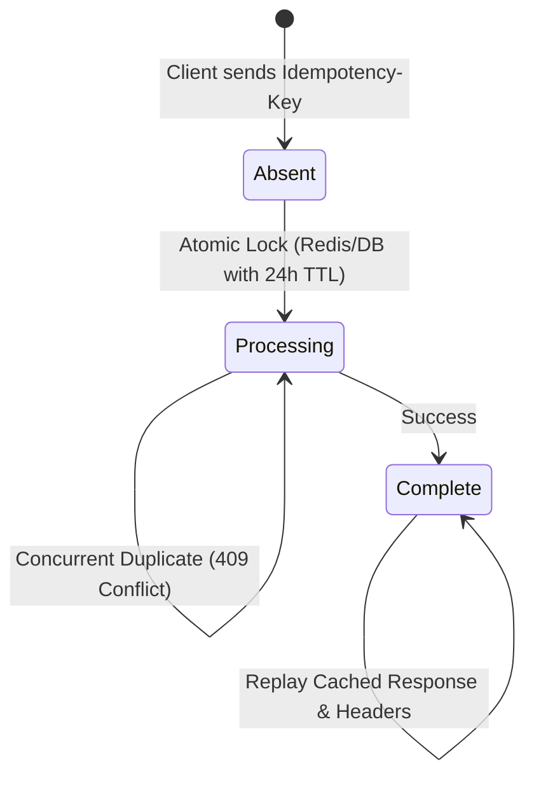

# Production Backend Patterns & Distributed Architecture

## Pattern 1: IETF Idempotency-Key & Stripe 3-State Model
Prevent duplicate billing or double credit allocation:


* **Parameter Mismatch Check**: Calculate `SHA-256(request_body)`. If the key is reused with a different payload, reject with `400 Bad Request`.
* **Multi-Tenant Key Scoping**: Store as `tenant_id + ":" + idempotency_key`.

---

## Pattern 2: Client-Side OffscreenCanvas Downsampling
Bypasses Vercel's strict 4.5MB serverless request body ceiling:
```typescript
export async function downsampleImage(file: File, maxDim = 1800, quality = 0.85): Promise<string> {
  const bitmap = await createImageBitmap(file);
  const scale = Math.min(maxDim / bitmap.width, maxDim / bitmap.height, 1);
  const canvas = new OffscreenCanvas(bitmap.width * scale, bitmap.height * scale);
  const ctx = canvas.getContext('2d');
  ctx?.drawImage(bitmap, 0, 0, canvas.width, canvas.height);
  const blob = await canvas.convertToBlob({ type: 'image/jpeg', quality });
  return new Promise((resolve) => {
    const reader = new FileReader();
    reader.onload = () => resolve(reader.result as string);
    reader.readAsDataURL(blob);
  });
}
```

---

## Pattern 3: Global CORS Preflight Handling
Enable public RapidAPI and developer access without CORS errors:
```typescript
export async function OPTIONS() {
  return new NextResponse(null, {
    status: 204,
    headers: {
      'Access-Control-Allow-Origin': '*',
      'Access-Control-Allow-Methods': 'GET, POST, OPTIONS',
      'Access-Control-Allow-Headers': 'Content-Type, Authorization, X-RapidAPI-Key, X-RapidAPI-Host, X-RapidAPI-Proxy-Secret',
    },
  });
}
```
