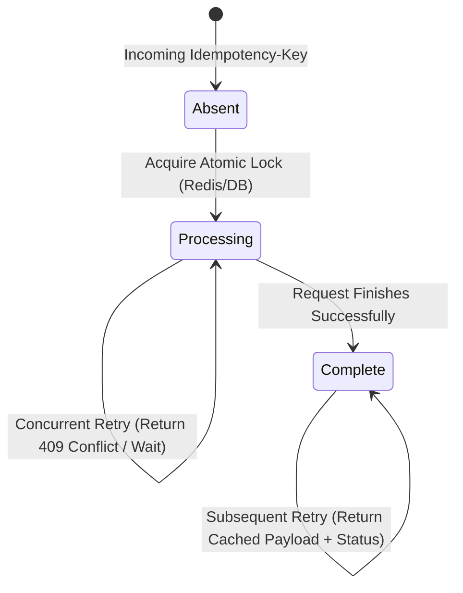

# Full-Stack Engineering & System Architecture Master Research Dossier

## 1. Stripe API Design Guide & IETF Idempotency-Key Standard

### 1.1 The Core Idempotency Challenge in Distributed Billing
HTTP `POST` and `PATCH` are non-idempotent by default. Under network timeouts or client retries, blind retries risk duplicate credit purchases or double billing.

### 1.2 The IETF Draft (`draft-ietf-httpapi-idempotency-key-header`) & Stripe 3-State Model



1. **State 1: Absent**: The key has never been seen. The server registers an atomic lock with 24-hour TTL and proceeds with execution.
2. **State 2: Processing (In-Flight)**: The request is executing. If a duplicate arrives while processing, the server rejects it with `409 Conflict` or awaits the lock to prevent duplicate execution.
3. **State 3: Complete**: Execution finished. The exact HTTP status code, headers, and response body are cached. Future requests with this key bypass execution and immediately return the cached response.
4. **Parameter Mismatch Protection (Payload Hashing)**:
   The server computes a SHA-256 hash of the request payload ($H = \text{SHA-256}(\text{body})$). If an incoming request reuses the same `Idempotency-Key` with a different payload, the server rejects with `400 Bad Request` ("Idempotency key parameter mismatch").
5. **Multi-Tenant Key Scoping**:
   Always scope the key by user or tenant: `Key = tenant_id + ":" + idempotency_key`.

---

## 2. Next.js 16 App Router Serverless Architecture & Edge Constraints

### 2.1 The 4.5MB Serverless Payload Barrier & OffscreenCanvas Solution
* Vercel Serverless Functions have an unyielding 4.5MB request payload limit.
* Modern smartphone camera photos range from 8MB to 25MB. Uploading raw files causes `413 Payload Too Large`.
* **Client-Side OffscreenCanvas Downsampling Protocol**:
  ```typescript
  export async function downsampleImage(file: File, maxDim = 1800, quality = 0.85): Promise<string> {
    const bitmap = await createImageBitmap(file);
    const scale = Math.min(maxDim / bitmap.width, maxDim / bitmap.height, 1);
    const canvas = new OffscreenCanvas(bitmap.width * scale, bitmap.height * scale);
    const ctx = canvas.getContext('2d');
    ctx?.drawImage(bitmap, 0, 0, canvas.width, canvas.height);
    const blob = await canvas.convertToBlob({ type: 'image/jpeg', quality });
    return new Promise((resolve) => {
      const reader = new FileReader();
      reader.onload = () => resolve(reader.result as string);
      reader.readAsDataURL(blob);
    });
  }
  ```

### 2.2 Partial Prerendering (PPR) & Non-Deterministic Values
* In Next.js 16, client components evaluated during prerendering must never read dynamic non-deterministic values (like `new Date()` or `Math.random()`).
* Dynamic timestamps must be deferred to `useEffect` or static constants.

---

## 3. Unified API Response Envelope (RFC 9457 Problem Details)

Every route implements standard envelope contracts:
```typescript
interface ApiResponse<T> {
  success: boolean;
  data?: T;
  error?: {
    code: string;
    message: string;
    details?: Record<string, unknown>;
  };
  meta: {
    platform: string;
    timestamp: string;
    processingTimeMs: number;
  };
}
```

---

## 4. DORA Engineering Reliability Metrics

* **Deployment Frequency**: Multiple on-demand releases daily via Vercel CI/CD.
* **Lead Time for Changes**: <15 minutes from commit to production edge.
* **Change Failure Rate**: <1% enforced by pre-deploy `./scripts/test_e2e.sh` test gate.
* **Mean Time to Recovery (MTTR)**: <5 minutes through instant Vercel rollback and fallback parsers.
