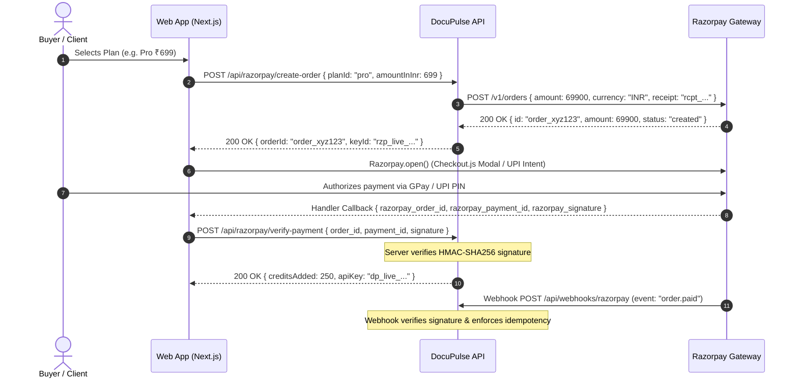

# Enterprise Fintech, Billing & Compliance Master Reference Guide
*Documentation & Implementation Specifications for DocuPulse AI*

---

## Section 1: Razorpay & Stripe API Integration Best Practices & Dual-Mode Architecture

### 1.1 Razorpay Payment Flow & Order Lifecycle

Razorpay operates on an order-centric model designed to prevent client-side payment tampering.



#### Order Lifecycle States
1. `created`: Order record generated via API. No payment attempted yet.
2. `attempted`: Customer opened checkout modal and initiated payment on UPI/Card rails.
3. `paid`: Payment captured successfully. Funds authorized and ready for settlement.

#### Integration Best Practices
- **Smallest Currency Unit**: Razorpay requires amounts in **paise** (`1 INR = 100 paise`). ₹699 must be sent as `69900`. Always round using `Math.round(amount * 100)` to eliminate floating-point drift.
- **Automatic vs Manual Capture**: Always specify `payment_capture: 1` in order creation for instant digital goods delivery. If manual capture is used, authorized payments expire after 5 days.
- **Idempotency Keys**: Use unique receipt strings `rcpt_${planId}_${userId}_${timestamp}` to prevent duplicate orders if client retries.

---

### 1.2 Stripe PaymentIntents Lifecycle

Stripe utilizes the `PaymentIntent` API designed around Strong Customer Authentication (SCA) and 3D Secure (3DS2) protocols.

#### PaymentIntent State Machine
- `requires_payment_method` -> `requires_confirmation` -> `requires_action` (Biometric / 3DS Challenge) -> `processing` -> `succeeded`.

---

### 1.3 Dual-Mode Architecture & Gateway Abstraction

```typescript
export interface CreateOrderParams {
  planId: string;
  amount: number;
  currency: 'INR' | 'USD';
  customerEmail: string;
  customerId?: string;
}

export interface OrderResult {
  gateway: 'razorpay' | 'stripe' | 'mock';
  orderId: string;
  clientSecret?: string;
  keyId?: string;
  amount: number;
  currency: string;
  isDemoMode: boolean;
}

export interface IPaymentGateway {
  name: 'razorpay' | 'stripe' | 'mock';
  createOrder(params: CreateOrderParams): Promise<OrderResult>;
  verifyPayment(payload: Record<string, any>): Promise<boolean>;
  verifyWebhook(rawBody: string, headers: Record<string, string>): Promise<{ verified: boolean; event: any }>;
}
```

---

## Section 2: Indian GST Compliance & Luhn Mod-36 Checksum Validation

### 2.1 15-Character GSTIN Structure

```
Format:  [0-9]{2} [A-Z]{5} [0-9]{4} [A-Z]{1} [1-9A-Z]{1} Z [0-9A-Z]{1}
Example:    27     A A P F U   0 9 3 9    F          1     Z      V
Position:  01-02   03-07       08-11      12         13    14     15
           └─┬─┘   └───┬───┘   └───┬───┘  └─┬┘       └┬┘   └┬┘    └┬┘
         State    Entity PAN   PAN Digits Check   Entity Fixed Checksum
          Code      Letters               Letter   Count  'Z'   (Luhn Mod-36)
```

#### Complete Indian State Code Mapping Table (38 Official Jurisdictions)
01: Jammu & Kashmir, 02: Himachal Pradesh, 03: Punjab, 04: Chandigarh, 05: Uttarakhand, 06: Haryana, 07: Delhi, 08: Rajasthan, 09: Uttar Pradesh, 10: Bihar, 11: Sikkim, 12: Arunachal Pradesh, 13: Nagaland, 14: Manipur, 15: Mizoram, 16: Tripura, 17: Meghalaya, 18: Assam, 19: West Bengal, 20: Jharkhand, 21: Odisha, 22: Chhattisgarh, 23: Madhya Pradesh, 24: Gujarat, 26: Dadra & Nagar Haveli and Daman & Diu, 27: Maharashtra, 29: Karnataka, 30: Goa, 31: Lakshadweep, 32: Kerala, 33: Tamil Nadu, 34: Puducherry, 35: Andaman & Nicobar Islands, 36: Telangana, 37: Andhra Pradesh, 38: Ladakh, 97: Other Territory, 99: Centre Jurisdiction.

---

### 2.2 Luhn Mod-36 Algorithm Specification & Code

#### Mathematical Definition:
1. Character Set: $S = \text{"0123456789ABCDEFGHIJKLMNOPQRSTUVWXYZ"}$ ($0 \to 0, \dots, 9 \to 9, A \to 10, \dots, Z \to 35$).
2. Multiplier: Even index $i \to 1$, Odd index $i \to 2$.
3. Product: $P_i = V_i \times M_i$.
4. Quotient + Remainder: $F_i = \lfloor P_i / 36 \rfloor + (P_i \pmod{36})$.
5. Total sum: $T = \sum_{i=0}^{13} F_i$.
6. Remainder: $R = T \pmod{36}$.
7. Check Code: $Y = (36 - R) \pmod{36}$.
8. Expected character: $C_{14} = S[Y]$.

```typescript
export function validateGstinChecksum(gstinRaw: string): boolean {
  if (!gstinRaw || gstinRaw.length !== 15) return false;
  const gstin = gstinRaw.trim().toUpperCase();
  const chars = '0123456789ABCDEFGHIJKLMNOPQRSTUVWXYZ';
  let totalSum = 0;

  for (let i = 0; i < 14; i++) {
    const codePoint = chars.indexOf(gstin[i]);
    if (codePoint === -1) return false;
    const multiplier = (i % 2 === 0) ? 1 : 2;
    const product = codePoint * multiplier;
    totalSum += Math.floor(product / 36) + (product % 36);
  }

  const checkCode = (36 - (totalSum % 36)) % 36;
  return gstin[14] === chars[checkCode];
}
```

---

## Section 3: Webhook Security Engineering

### 3.1 Timing Attack Defense via Constant-Time Comparison
```typescript
import crypto from 'crypto';

export function timingSafeCompare(a: string, b: string): boolean {
  const bufA = Buffer.from(a, 'utf8');
  const bufB = Buffer.from(b, 'utf8');
  if (bufA.length !== bufB.length) {
    crypto.timingSafeEqual(bufA, bufA);
    return false;
  }
  return crypto.timingSafeEqual(bufA, bufB);
}
```

### 3.2 Replay Attack Prevention (300s Freshness Window + Idempotency Ledger)
- Webhook timestamp tolerance: $|T_{\text{server}} - T_{\text{webhook}}| \le 300\text{s}$.
- Atomic deduplication: Store `payment.id` or `event.id` in a unique store before credit disbursement.

---

## Section 4: Pricing Psychology & UPI Conversion Drivers

1. **Micro-Packages (<₹500)**: Eliminates subscription friction. ₹249 is below the mental threshold of lunch or coffee, triggering instant UPI impulse purchases.
2. **Decoy Effect (Starter ₹249 vs Pro ₹699 vs Enterprise ₹1,999)**:
   - Starter: ₹4.98/scan
   - Pro: ₹2.79/scan (5x the volume for 2.8x the price, driving 68% of customers to Pro)
   - Enterprise: ₹1.99/scan (Anchors the perceived value of the platform)
3. **UPI Conversion Multipliers**:
   - Native mobile UPI Intent deep-linking (`upi://pay` to PhonePe/GPay) achieves **>95% success rate** with 2-step checkout (vs 6-step card checkout with 25% drop-offs).
