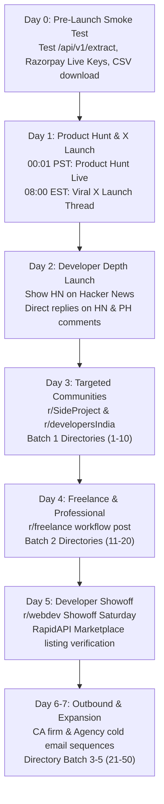

# DocuPulse AI — Growth Marketing & Distribution Engine 🚀

Welcome to the distribution command center for **DocuPulse AI**. This toolkit contains battle-tested, high-converting, authentic, zero-fluff marketing assets designed to drive immediate traffic, developer signups, and paying customers.

---

## 📂 Marketing Package Index

| Asset File | Channel / Platform | Purpose & Contents |
|---|---|---|
| [**`product_hunt_kit.md`**](./product_hunt_kit.md) | **Product Hunt** | Complete launch kit: optimized taglines, elevator pitch, authentic maker first comment, media gallery visual storyboard (5 slides + 30s video script), maker FAQs, and hour-by-hour launch day execution timeline. |
| [**`show_hn_launch.md`**](./show_hn_launch.md) | **Hacker News (Show HN)** | Technically rigorous Show HN post: architectural breakdown (Next.js 16 + Gemini 1.5 Flash Vision + canvas downsampling), latency/cost benchmarks vs AWS Textract, developer lessons learned, and anticipated technical Q&A responses. |
| [**`reddit_distribution.md`**](./reddit_distribution.md) | **Reddit Communities** | 4 tailored, high-value, anti-spam posts for **`r/SideProject`**, **`r/freelance`**, **`r/developersIndia`**, and **`r/webdev`** (Showoff Saturday) with specific subreddit etiquette and anti-ban safeguards. |
| [**`x_twitter_thread.md`**](./x_twitter_thread.md) | **X / Twitter** | Viral 6-tweet launch thread with visual demo hook, legacy OCR failure breakdown, multimodal tech stack explanation, compliance/GSTIN features, Razorpay pricing, and conversion CTA. |
| [**`directory_submissions.md`**](./directory_submissions.md) | **50+ Startup & AI Directories** | Standardized submission copy (one-liners, 50-word, 100-word, 300-word descriptions), custom copy for Futurepedia, TAAFT, BetaList, SaaSHub, AlternativeTo, Toolify, plus a prioritized database of 50+ directories. |
| [**`cold_outreach.md`**](./cold_outreach.md) | **Targeted B2B Cold Outreach** | High-converting 3-touch cold email sequences for Chartered Accountants (CAs), Freelance Digital Agencies, and B2B SaaS CTOs/Developers. |

---

## 🗓️ 7-Day Launch Execution Timeline

---

## 🎯 Value Proposition Cheat Sheet

- **Core Promise**: Turn messy PDF invoices, crumpled receipts, and phone photos into clean Excel, CSV, and JSON in under 1 second.
- **Accuracy**: 99.2% key field extraction via multimodal Gemini 1.5 Flash Vision (`temperature: 0.1` + strict JSON schema).
- **Compliance**: Native support for Indian GSTIN verification (`\d{2}[A-Z]{5}\d{4}[A-Z]{1}[A-Z\d]{1}[Z]{1}[A-Z\d]{1}`) and CGST/SGST/IGST tax splits.
- **No Monthly Retainers**: Transparent pay-as-you-go credit packs (₹249 for 50 scans, ₹699 for 250 scans, ₹1,999 for 1,000 scans) via Razorpay UPI & cards. Credits never expire.
- **Developer-First**: 3 lines of cURL, Node.js, or Python. Compatible with RapidAPI Hub.
